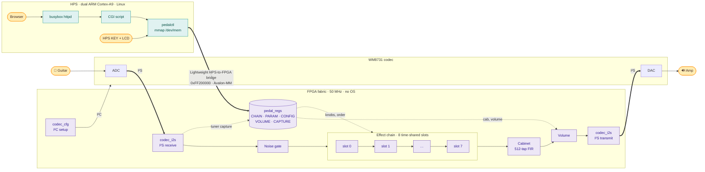

---
hide:
  - navigation
  - toc
---

# :material-guitar-electric: PedalFPGA

A real-time guitar multi-effect running entirely in the FPGA fabric of a **DE10-Standard**, with
Linux on the ARM turning the knobs. No operating system in the signal path: one sample in, one
sample out, every 20.8 µs.

[Install it :material-download:](install.md){ .md-button .md-button--primary }
[Build it step by step :material-school:](codec.md){ .md-button }
[Source on GitHub :fontawesome-brands-github:](https://github.com/devfernandoa/PedalFPGA){ .md-button }

<b>11</b>effects, VHDL

<b>8</b>slots, any order

<b>48 kHz</b>exact, via a fractional PLL

<b>1041</b>clock cycles per sample

<b>0</b>samples differing from the Python model

## Architecture

The audio (thick arrows) never leaves the FPGA. Linux only writes **registers** (dotted arrows):
which effects are on and in what order, the knobs, the input and the volume. The FPGA picks the
new values up between two samples, so changes are instant and click-free.

## What's inside

-   :material-tune-vertical:{ .lg .middle } **11 effects, 2 knobs each**

    ---

    Booster, distortion, overdrive, tremolo, delay, auto-wah, phaser, reverb, compressor, chorus
    and flanger. Up to 8 in any order, plus a noise gate, a cabinet simulator and an output volume.

-   :material-check-decagram:{ .lg .middle } **Bit-exact verification**

    ---

    Every effect has an integer Python model. A GHDL testbench runs the VHDL and compares the
    output with the model, sample by sample.

-   :material-web:{ .lg .middle } **Web UI and CLI**

    ---

    Drag stompboxes to reorder them, turn the knobs, save presets and tune your guitar from a
    browser, or script everything with `pedalctl`.

-   :material-gamepad-variant:{ .lg .middle } **A real front panel**

    ---

    The HPS KEY button steps through presets and the on-board LCD shows the preset name, so the
    board works as a pedal with no computer attached.

## Two ways to use this site

-   :material-rocket-launch:{ .lg .middle } **Just run it**

    ---

    Build the bitstream and the software and put them on the board, in one page.

    [:octicons-arrow-right-24: Install](install.md)

-   :material-school:{ .lg .middle } **Understand and rebuild it**

    ---

    A five-part tutorial: the codec, a first effect, the chain, the HPS registers, the Linux side.
    Theory where it is needed, and a checkpoint you can run at the end of each part.

    [:octicons-arrow-right-24: Start the tutorial](codec.md)

| Part | You learn | You get |
|------|-----------|---------|
| [1. Talking to the codec](codec.md) | I²C, I²S, clocking an audio codec | Guitar in → FPGA → amp, bit for bit |
| [2. Your first effect](effect.md) | Fixed-point DSP, LFOs, checking HDL against a model | A tremolo, tested in GHDL |
| [3. A chain of effects](chain.md) | Time-multiplexing, cycle budgets, multicycle constraints | Any effects, any order |
| [4. Registers for the HPS](hps.md) | Avalon-MM slaves, Platform Designer, the LW bridge | Knobs the ARM can turn |
| [5. Control from Linux](linux.md) | `/dev/mem` + `mmap`, cross-compiling, CGI | `pedalctl` and a web UI |
| [When it goes wrong](troubleshooting.md) | The critical points and how to debug them | |
| [Going further](further.md) | Where to go next, references | |

## Where this fits in the course

This is a student tutorial for **Embarcados Avançados** (SoC and Embedded Linux) at Insper. The
[course tutorials](https://insper.github.io/Embarcados-Avancados/) show how to blink an FPGA LED from
the HPS, and the 2020 student tutorial
[Audio na DE10](https://insper.github.io/Embarcados-Avancados/2020/Audio/) gets sound in and out of
the codec. This one goes further on both sides: a hand-written codec interface at exactly 48 kHz, DSP
in fixed point verified bit by bit, a time-multiplexed effect chain with its timing constraints, and
a custom Avalon peripheral driven from user space.

**Before you start** you should have done the course tutorials up to
[Blink FPGA LED from HPS](https://insper.github.io/Embarcados-Avancados/Tutorial-HPS-FPGA-BlinkLED/):
compile a Quartus project, boot the board from the SD card and `ssh` into it. The full list of
hardware and software is on the [Install](install.md#what-you-need) page.

!!! info "A few numbers to keep in mind"
    - Sample rate \(f_s = 48\,\text{kHz}\): one sample every \(1/f_s = 20.83\,\mu\text{s}\)
    - FPGA clock 50 MHz: **1041 clock cycles per sample**. Every effect in the chain has to fit in that budget.
    - Samples are 16-bit signed (−32768 … 32767) inside the effects, 24-bit at the codec.

<small>Fernando Alzueta · Insper, Embarcados Avançados · board: Terasic DE10-Standard (Cyclone V SoC 5CSXFC6D6)</small>
