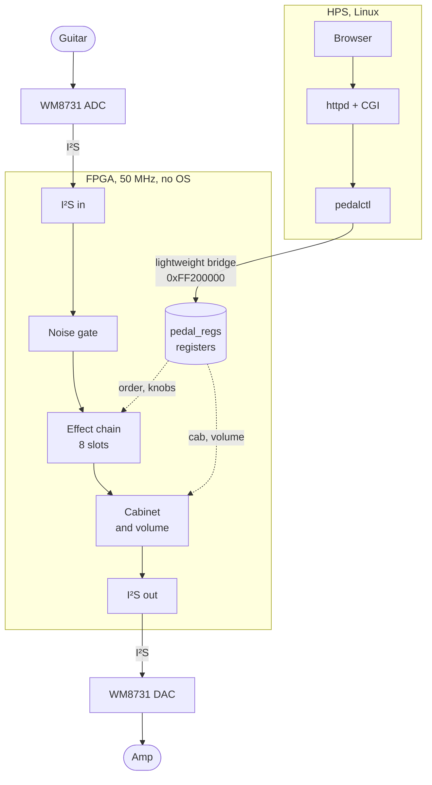

---
hide:
  - navigation
---

# PedalFPGA

A real-time guitar multi-effect for the Terasic **DE10-Standard** (Cyclone V SoC). The audio runs
entirely in FPGA logic, one sample in and one sample out every 20.8 µs, with no operating system in
the signal path. Linux on the ARM (the HPS) only sets the pedal up: which effects are on, in which
order, and where the knobs are.

- 11 effects: booster, distortion, overdrive, tremolo, delay, auto-wah, phaser, reverb, compressor,
  chorus, flanger. Up to 8 in any order, two knobs each.
- Noise gate before the chain; cabinet simulator (512-tap FIR) and output volume after it.
- Exactly 48 kHz through the on-board WM8731 codec.
- Control from the command line (`pedalctl`), a web page served by the board, or the board's own
  button and LCD.
- Every effect has an integer Python model, and a GHDL test checks the VHDL against it sample by sample.

Source code: [github.com/devfernandoa/PedalFPGA](https://github.com/devfernandoa/PedalFPGA).
To just build it and play, go to [Install](install.md). To understand how it works, start the
[tutorial](codec.md).

## Architecture

Solid arrows carry audio, dotted arrows carry settings. The sample never leaves the FPGA; the HPS
writes registers, and the FPGA reads them between two samples, so a change is heard at the next
sample, without clicks. Not shown: `codec_cfg`, which sets the codec up over I²C at power-up, and the
capture buffer the tuner uses to read input samples back.

## The tutorial

| Part | You learn | You get |
|------|-----------|---------|
| [1. Talking to the codec](codec.md) | I²C, I²S, clocking an audio codec | Guitar in → FPGA → amp, bit for bit |
| [2. Your first effect](effect.md) | Fixed-point DSP, LFOs, checking HDL against a model | A tremolo, tested in GHDL |
| [3. A chain of effects](chain.md) | Time-multiplexing, cycle budgets, multicycle constraints | Any effects, any order |
| [4. Registers for the HPS](hps.md) | Avalon-MM slaves, Platform Designer, the LW bridge | Knobs the ARM can turn |
| [5. Control from Linux](linux.md) | `/dev/mem` + `mmap`, cross-compiling, CGI | `pedalctl` and a web UI |
| [When it goes wrong](troubleshooting.md) | The critical points and how to debug them | |
| [Going further](further.md) | Where to go next, references | |

Each part ends with a checkpoint you can run. Do them in order: every part uses the previous one.

**Before you start** you should have done the course tutorials up to
[Blink FPGA LED from HPS](https://insper.github.io/Embarcados-Avancados/Tutorial-HPS-FPGA-BlinkLED/):
compile a Quartus project, boot the board from the SD card and `ssh` into it. The hardware and
software you need are listed on the [Install](install.md#what-you-need) page.

!!! info "Numbers to keep in mind"
    - Sample rate \(f_s = 48\,\text{kHz}\): one sample every \(1/f_s = 20.83\,\mu\text{s}\)
    - FPGA clock 50 MHz: **1041 clock cycles per sample**. Every effect in the chain has to fit in that budget.
    - Samples are 16-bit signed (−32768 … 32767) inside the effects, 24-bit at the codec.

## Where this fits in the course

This is a student tutorial for **Embarcados Avançados** (SoC and Embedded Linux) at Insper, by
Fernando Alzueta. The [course tutorials](https://insper.github.io/Embarcados-Avancados/) show how to
blink an FPGA LED from the HPS, and the 2020 student tutorial
[Audio na DE10](https://insper.github.io/Embarcados-Avancados/2020/Audio/) gets sound in and out of
the codec. This one goes further on both sides: a hand-written codec interface at exactly 48 kHz, DSP
in fixed point verified bit by bit, a time-multiplexed effect chain with its timing constraints, and
a custom Avalon peripheral driven from user space.
